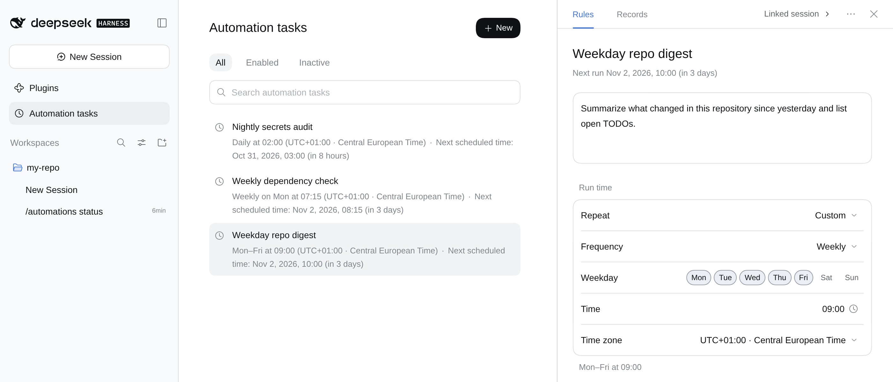
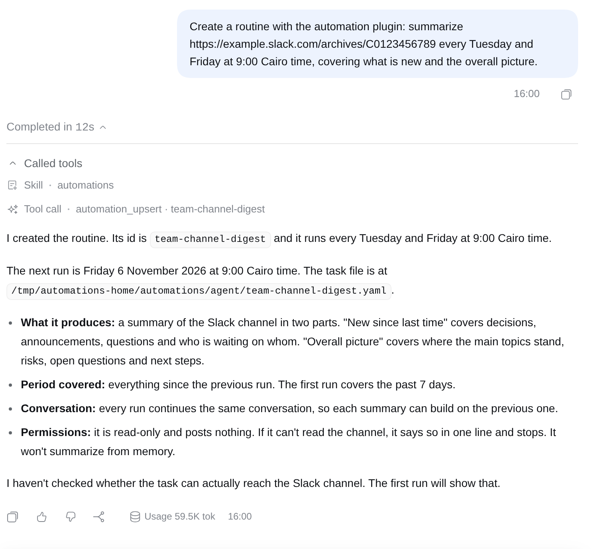
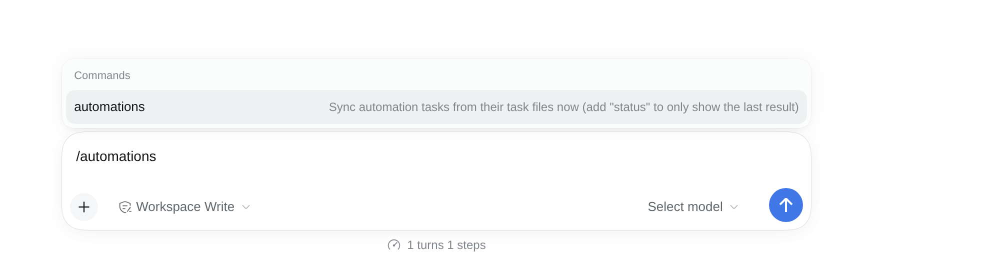
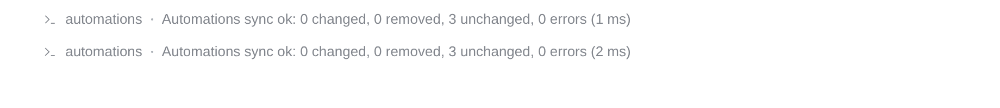

# @rs-dsh/dsh-automations

Keep your [DeepSeek Harness](https://github.com/deepseek-ai/deepseek-harness) automation tasks in files. Write each task (its schedule, prompt, model, permission and working folder) in a YAML, JSON or JS file, and the plugin makes the Schedule match: it creates, updates, disables and deletes tasks so that they are exactly what the files say. Or ask the agent: "summarise this channel every Tuesday and Friday at 9" becomes a task file too.



## Install

```sh
dsh plugin --profile <name> add @rs-dsh/dsh-automations@0.2.0-rc.3
```

To install from this repository instead, pinned to the release tag:

```sh
dsh plugin --profile <name> add 'github:romany-saad/dsh-plugins#dsh-automations@0.2.0-rc.3&path:packages/dsh-automations'
```

Restart DSH after installing.

## Requirements

- DSH 0.2.2-rc.1 or later. It is tested with 0.2.2-rc.1. DSH 0.2.2 changed how plugins talk to the Schedule, so on DSH 0.2.1 stay on the previous release, 0.2.0-rc.2.
- A profile with the Schedule (`@deepseek-ai/dsh-schedule`), which the `web` profile has. Its **Automation tasks** page, where you see and edit tasks, is part of `@deepseek-ai/dsh-web-app`.

## Use

### Write your tasks

Put task files in `~/.dsh/automations/` (the folder is `$DSH_HOME/automations`). Every `.yaml`, `.yml`, `.json`, `.js` and `.mjs` file in it, and in its subfolders, adds tasks. Files whose names start with `_` or `.` are skipped, so you can keep drafts as `_draft.yaml`.

```yaml
defaults:                         # for every task in this file
  cwd: /path/to/your/repo         # the folder the task works in
  timeZone: Europe/Berlin
  permission: read-only           # read-only, workspace-write or danger-full-access
  model: claude/claude-opus-5-5   # or { provider, model, reasoningEffort }
tasks:
  - id: repo-digest               # never reuse an id for another task
    title: Daily repo digest
    schedule:
      cron: "30 8 * * 1-5"
    prompt: |
      Summarize what changed in this repository since yesterday.
```

A file holds a list of tasks, `{ defaults, tasks }`, or one task. A `.js` or `.mjs` file exports the same as `default`, or a function that returns it. [`examples/tasks.yaml`](examples/tasks.yaml) is a file to copy.

Each task has:

| Field | Required | What it is |
|---|---|---|
| `id` | yes | The task's identity: letters, digits, `.`, `_` and `-`, up to 100 characters. Renaming it makes a new task. |
| `prompt` | yes, or `promptFile` | The message the task sends when it runs. |
| `promptFile` | no | A file to read the prompt from, instead of `prompt`; give one of the two. A relative path is read from the task file's folder. The file is read when the task file is synced, and saving it syncs the task, so edit the prompt in its own file. It must not be empty. |
| `schedule` | yes | When it runs; see below. |
| `cwd` | no | The folder it works in. A relative path is read from the task file's folder. Leave it out for a task that needs no project folder, such as a digest: it works in DSH's **Default workspace**. |
| `title` | no | The name on the Automation tasks page, up to 120 characters. Defaults to the id. |
| `timeZone` | no | Defaults to your computer's time zone. |
| `model` | no | `provider/model`, or `{ provider, model, reasoningEffort }`. |
| `permission` | no | A permission preset name. |
| `agentPreset` | no | An agent preset name. |
| `session` | no | `persistent` (the default) or `fresh`; see below. |
| `enabled` | no | `false` takes the task off the Schedule and keeps its conversation. |

`schedule` takes exactly one of:

- `cron: "30 8 * * 1-5"`: a five-field cron expression.
- `daily: "09:00"`.
- `weekly: { time: "08:30", weekdays: [mon, thu] }`: days as names or 1 (Monday) to 7 (Sunday).
- `every: 15m`: at least a minute; `s`, `m`, `h` or `d`.
- `at: 2026-12-01T09:00:00+02:00`: once.

Add `timeZone:` inside `schedule` to give one schedule its own time zone.

### Or ask the agent

Ask in any conversation for a routine, for example *"summarise https://example.slack.com/archives/C0123 every Tuesday and Friday at 9:00 with what's new and the overall picture"*. The agent loads the plugin's `automations` skill and creates the task with the `automation_upsert` tool. The tool writes the task as its own file in `~/.dsh/automations/agent/` and syncs it, so the task is a file like any other, and you can open and edit it. The agent replies with the task id, its schedule and its next run.



What the agent can do:

| Tool | What it does |
|---|---|
| `automation_list` | Lists the tasks, with their next run, their conversation and the file each comes from. It also lists reminders on the Schedule that no task manages. |
| `automation_upsert` | Creates or replaces a task in the agent folder, then syncs. A task DSH refuses is undone, so nothing half-made is left behind. |
| `automation_remove` | Removes a task the agent created. Its conversation stays. |
| `automation_sync` | Syncs now, the same as `/automations`. |
| `automation_adopt` | Turns a reminder made with DSH's built-in scheduling into a task, then deletes the reminder so the work doesn't run twice. |

- **Your files stay yours.** The tools change only files in the agent folder. For a task from a file you wrote, the agent tells you which file to edit.
- **Read-only unless you agree.** A task the agent creates is `read-only` by default. Asking for `workspace-write` or `danger-full-access` shows you an approval first, because the task runs on its own.
- **The agent knows when to use them.** The plugin tells the agent to use these tools for routines, and DSH's built-in `schedule_create` only for a reminder in the current conversation.

### What happens when you save

Saving a file syncs within a second or so. You can also type `/automations` in the message box of a conversation to sync now, or `/automations status` to see the result of the last sync without syncing.



The result shows in the conversation as a command line, not as a message to the model:



| You change | What happens |
|---|---|
| title, prompt or schedule | The task is updated in place and keeps its history. A new title also renames its conversation. |
| model | Used in that task's conversation only. Your default model does not change. |
| permission | Set on that task's conversation. |
| `cwd` or `agentPreset` | The task moves to a new conversation. |
| `enabled: false` | The task leaves the Schedule. Its conversation stays. |
| you delete the task | The task leaves the Schedule. |
| you edit, pause or delete the task on the Automation tasks page | The next sync puts it back as the file says. |
| a file has a mistake | Nothing changes until you fix it. `/automations` names the file, the task and the problem. |
| DSH refuses a task, for example a bad cron | The task keeps its last good schedule, and the error shows until you change that task. After an upgrade of this plugin, a refused task is tried once more. |

If the files hold no tasks at all, the plugin refuses to delete every task, so an empty or moved folder does not wipe your Schedule. Set `allowEmpty: true` to allow it.

### Each task has its own conversation

Each task runs in a conversation of its own, titled `⏱ <title>`. With `session: persistent`, every run is a new message in that same conversation, so the task remembers earlier runs. That suits a digest: "what's new since last time" works because the previous summary is right there.

With `session: fresh`, every run starts a new conversation that holds only the task's prompt, titled `⏱ <title> · <date and time>`. The newest 10 run conversations are kept and older ones are archived. The task's own conversation stays, so the Automation tasks page still lists and edits it, but nothing runs in it.

**A welcome message.** When the plugin creates a task's conversation, it starts it with a two-sentence message to the model, which answers you in a few lines: the task's name, when it runs, where its runs appear, which file defines it, and a suggestion to pin the conversation. The message carries the task's title, schedule and file, and none of its prompt. The conversation then has a message of its own. Without one, DSH treats it as an empty conversation and gives it to the next new conversation you start in that folder, with the task's title. This costs one model call per new task. A `persistent` task's welcome uses the task's own model and permission; a `fresh` task's conversation never runs the task, so its welcome uses your default model. It is sent once. If DSH cannot accept the message, the sync still succeeds and the next sync tries again. If it accepts the message but the model call then fails (no API key or model configured, for example), the conversation shows a failed turn and the welcome is not sent again; configure a model before you add tasks, or set `intro: false`. Tasks that already existed are left alone.

**Archiving.** A task's conversation is kept visible: if you archive it, the next sync restores it, as long as the task is enabled. To get rid of it, disable or delete the task. (Run conversations of a `fresh` task are not restored; the plugin archives them itself after the newest 10.)

## Configure

It works with no config. To change something, add a `dsh-automations` row to the profile's `cordis.patch.yml`. A row with the same id replaces the whole config, so put every setting you change in that one row:

```yaml
- id: dsh-automations
  name: '@rs-dsh/dsh-automations'
  config:
    sources:
      - /home/me/automation        # folders or single files
    defaults:
      timeZone: Africa/Cairo
      permission: read-only
```

| Option | Default | What it does |
|---|---|---|
| `sources` | `[automations]` | Task folders or files. When you set it, a folder that does not exist is an error. |
| `baseDir` | `$DSH_HOME` | Where relative `sources` paths start. |
| `defaults` | none | Task fields for every file; a file's own `defaults` override them. |
| `allowEmpty` | `false` | `true` lets a sync with no tasks delete every task. |
| `archiveRemovedSessions` | `false` | `true` also archives the conversation of a task you delete. |
| `intro` | `true` | Start each new task conversation with a welcome message from the model. `false` leaves it empty. |
| `sessionTitlePrefix` | `⏱ ` | Put in front of each task's conversation title. `false` leaves titles alone. |
| `keepRunSessions` | `10` | How many run conversations a `fresh` task keeps. |
| `watch` | `true` | Sync when a task file changes. |
| `pollMs` | `10000` | Also check the files this often, in milliseconds. `0` turns it off. |
| `debounceMs` | `750` | Wait this long after a change before syncing. |
| `syncOnScheduleChange` | `true` | Sync when the Schedule changes, so an edit on the page is put back. |
| `runRetryMs`, `runMaxAttempts` | `30000`, `5` | How a `fresh` run that fails to start is retried. |
| `tools` | `true` | `false` gives the agent no automation tools, no `automations` skill and no guidance. |
| `agentDir` | `automations/agent` | Where the agent's task files go, from `baseDir`. It is always read, along with `sources`. |
| `statusFile` | `$DSH_HOME/data/dsh-automations/status.json` | Where the last sync's result is written. `false` writes none. |

## Limits

- **The files win.** A change you make on the Automation tasks page to a task from a file is undone at the next sync. Tasks you create on the page yourself are left alone.
- **One DSH at a time.** Two DSH processes reading the same task files would each try to manage the same tasks.
- **A `.js` task file runs as code** inside DSH. Only use files you trust.
- **The Default workspace** is DSH's own. In a profile without one (you deleted it), each task needs a `cwd`; `/automations` names every task that lacks one.
- **No screen of its own.** You see the tasks on DSH's Automation tasks page and the sync result through `/automations`.
- **Model per conversation** uses a part of DSH that is not a public API yet. If a DSH update removes it, `/automations` reports an error for each task with a `model`, and those tasks are not updated until you remove the `model` or update the plugin.

## More

[Changelog](CHANGELOG.md) · [MIT license](LICENSE) · [Developing](DEVELOPING.md)
