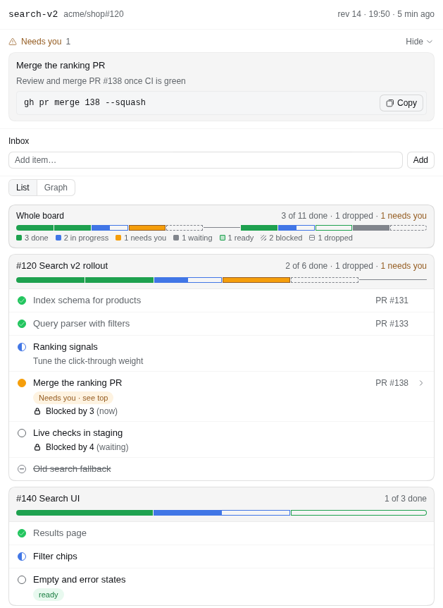
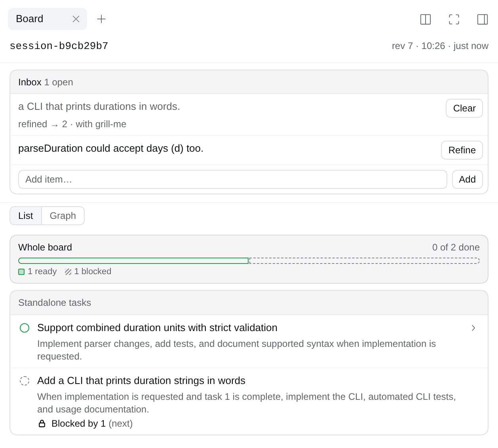
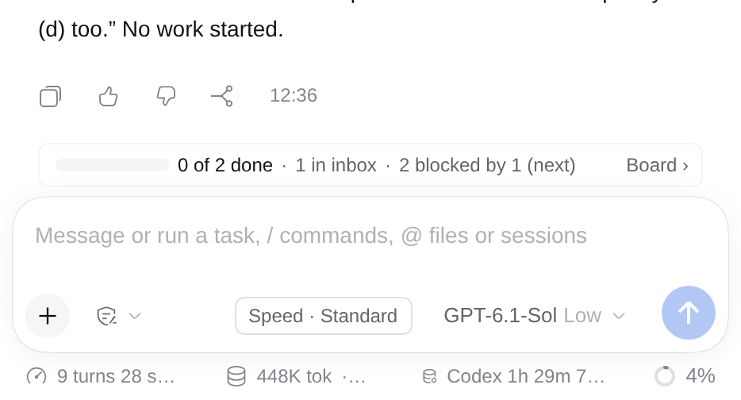
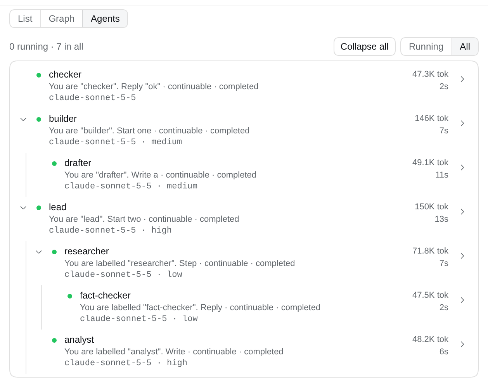
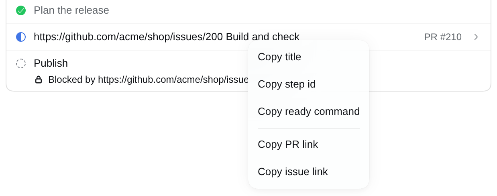
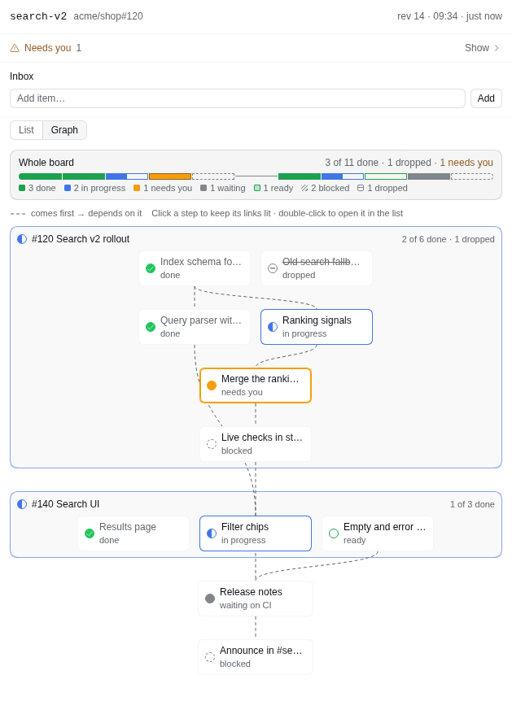
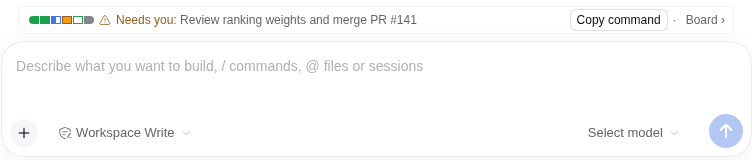
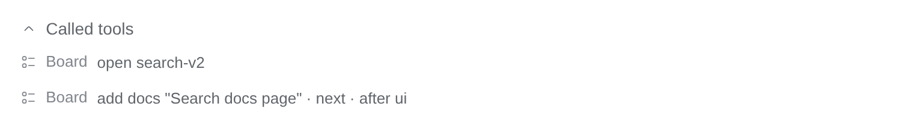

# @rs-dsh/dsh-cockpit

A task board for [DeepSeek Harness](https://github.com/deepseek-ai/deepseek-harness) sessions: the plan for work that takes several steps, from one change across a few files to an effort coordinated across many pull requests. The board is a tree of steps, each linked to its issue and PR, kept as a local file that you and your scripts can read.



## What you get

- **Six board tools** for the agent: open a board, read it, add steps, update them, keep its Inbox, and map the project process.
- **An Inbox** for rough ideas noted for later, kept on the board but outside its steps until they are refined.
- **The `cockpit-refine` and `cockpit-process` skills**, which turn ideas into requirements and discover the project development process.
- **Per-project process map** in `.dsh/cockpit/process.yml`: ordered stages, exit checks, skills, and compact/expanded stage tracks on tasks.
- **The Board tab** in the web GUI's right sidebar: whole-board progress with a count of each state, a "Needs you" list you can hide, separate sections for each top-level parent and its children, and a Standalone tasks section. Each parent has its own local progress. Each step shows its status mark, what blocks it, and links to its PR and issue; hover a mark for its status and a title for the step id. It uses DSH's own icons and status marks, in the light and dark themes. A **Graph** view draws the same steps as a diagram of parents and dependencies.
- **A progress strip** above the chat input: how far the board is, and what is blocked or needs you.
- **A card per board tool call** in the chat.
- **A small reader** for scripts, with no DSH needed.

The panel and the strip only show the board. They run no command and change nothing. The Inbox's buttons send a request to the agent, and the agent makes the change.

## Install

```sh
dsh plugin --profile <name> add @rs-dsh/dsh-cockpit@0.6.0-rc.10
```

If npm is not an option, install from git, pinned to the release tag: `dsh plugin --profile <name> add 'github:romany-saad/dsh-plugins#dsh-cockpit@0.6.0-rc.10&path:packages/dsh-cockpit'`.

The Board tab, the strip and the chat cards need a profile with `@deepseek-ai/dsh-web-app`, such as `web`.

## Configure

It works with no config. To change something, add a `dsh-cockpit` row to the profile's `cordis.patch.yml`, naming only what you change. Keep one such row: a row with the same id replaces the whole config, so put every setting you change in it. To link `#12` and `owner/repo#12` to GitHub:

```yaml
- id: dsh-cockpit
  name: '@rs-dsh/dsh-cockpit'
  config:
    links:
      issue: 'https://github.com/{repo}/issues/{number}'
      pr: 'https://github.com/{repo}/pull/{number}'
```

For `#12`, `{repo}` comes from the board's parent ticket. Without `links`, only full URLs become links.

- `tools: { enabled: false }` registers no board tools.
- `route: { enabled: false }` turns off the data the Board tab and the strip read; the tab then says the board is unavailable.
- `planning: { enabled: false }` stops asking agents to plan multi-step work on a board (see Use). They still keep a board current once one is open.
- `inbox: { refineSkill: 'grill-me' }` names the skill `/cockpit-refine` uses for the analysis when you name none (see Inbox). By default it uses its own checklist.
- `inbox: { sendOnClick: false }` makes the Inbox's **Refine**, **Refine all** and **Clear** buttons only fill the message box for you to send, instead of queueing the request for the agent.
- `replaces: { todo: false }` keeps DSH's built-in `todo_write` tool available alongside a bound board. By default it is hidden for the session while a board is bound; subagents always keep their own todo list.

### Drift

Drift is a step whose status no longer matches its work, such as a merged PR on a step that still says `waiting`. The plugin knows no tracker, so the check is a command you configure, `drift: { command: '...', cwd: '...' }`; it runs only when the agent asks for a drift check. What the command gets and must print is in the example and in DEVELOPING.md (linked below). In `mode: report` (the default) it only reports the differences, and the hub decides what to change; in `mode: apply` it sets the reported statuses itself. [`examples/board-drift-gh.sh`](examples/board-drift-gh.sh) is an example to copy: it reports steps whose PR `gh` says is merged.

## Use

Cockpit asks the agent to plan any work that takes several steps on a board, in place of DSH's todo list. Before it starts, the agent opens a board, or keeps using the one the session has, and adds the steps. A question or a one-step request gets no board. While a board is open, the agent keeps its steps and next actions current and checks its work before marking a step done. A subagent doesn't open its own board: it reports to the agent that gave it the task, which records the result.

This is guidance in the agent's instructions, not automatic tracking: check the board and correct it when needed. You can also ask for a board by name. Child sessions have separate bindings.

- **Open a board** with a key, such as `bosla-883`, and optionally the parent ticket. The session stays bound to it, also after a resume.
- **Add steps**, each with what it is and its issue or PR. `parent` puts a step under another; `dependsOn` lists steps that come first, so a step shows as blocked until they are done or dropped. Both must name steps already on the board: the agent adds a step first, then links others to it.
- **Update a step** as the work moves: `next`, `now`, `waiting`, `done` or `dropped`, and a next action.
- **Needs you:** a step with `waitingOn: user` shows in the "Needs you" list and on the strip, with its next action, and its `readyCommand` to copy when it has one.

Use `user` when a step needs your action, and a name or specific role such as `reviewer` for someone else. Process-map stages likewise use `who: user` for your actions. Existing boards and process maps using the older `owner` value still work; no manual migration is needed.

## Keep this session free: `/cockpit-delegate`

Type `/cockpit-delegate` to make this session a coordinator for the rest of the conversation. It stops doing the work itself and hands every piece to a subagent, so it stays free: you can ask questions, steer and add work while the subagents run.

- Each piece of work goes to a subagent named after its job (`builder`, `researcher`, `docs`), with a complete brief, since a subagent does not see this conversation. The session notes on the board who works on which step, tells you in a line, and ends its turn instead of waiting.
- Long efforts stay with the same subagent: follow-ups ("now add the tests", "fix the review comments") go to it with `send_message`, so it keeps what it already knows. A new subagent starts only for a separate line of work.
- When a subagent reports, the session checks its work, updates the board and tells you what changed. Questions from subagents come to you; your answers go back to them.
- Follow them in the Board tab's **Agents** view.
- If DSH refuses a subagent (its depth or capacity limit, or a model that is not allowed), the session asks you before doing that piece itself.

Say "stop delegating" to go back to normal. The agent can also load the skill when you ask it to delegate everything.

## Inbox

When an idea comes up that isn't for now, say so in the chat: "item for later: dark mode for the strip", "todo next: …", "add to the inbox: …". The agent writes it to the board's **Inbox** as you said it and carries on with the current work. If the session has no board yet, the first item opens one, named after the session. You can also type an item into **Add item…** on the Board tab.

Inbox items aren't steps. They don't count in progress, nothing can depend on them, and the strip only says "1 in inbox". They become steps when you refine them.



### Refining items into steps

Type `/cockpit-refine` to refine every open item, or `/cockpit-refine i3 i5` for some of them; **Refine** on an item does the same. The `cockpit-refine` skill then:

1. reads the board and finds what each item relates to: a parent, steps it depends on or blocks, and anything that already covers it;
2. closes the gaps (goal, scope, acceptance, relations, risks), asking you only what it can't work out;
3. proposes the steps the items become, in board terms, and waits for your yes;
4. writes them, each linked to the items it came from, so an item shows "refined → 12, 13".

**Your own skill for the analysis.** `/cockpit-refine i3 using grill-me`, or `inbox.refineSkill` in the config, hands step 2 to another skill in your catalog, such as one that interviews you or writes specs. Cockpit stays in charge of the board: the other skill decides how to analyse and what to ask, and Cockpit decides what gets written and where. An item that needs research rather than your answers can go to a subagent, which returns its analysis; the session writes the steps.

On the Board tab, a refined or dropped item has **Clear**, which hides it from the tab and keeps it in the board file. An item that won't be done is dropped, with a note why.



### Progress

The strip above the message box shows progress across the whole board: one segment per leaf step (a step with no children), including standalone top-level steps. Parents are not counted again, so a completed group cannot hide a waiting step elsewhere on the board. Done and dropped are counted separately. The **Whole board** bar, the first card above the sections, uses the same counts as the strip, and both put their segments in the order the sections are drawn. It lines up with every parent's bar, and a key under it counts each state. A bar with too many steps for its width shows one run per state instead of its segments, so it still reads how much is done, moving, waiting and left. Below it, each top-level parent and its subtree occupy a separate bordered section; root steps without children appear under **Standalone tasks**. Each parent's local bar counts only its direct children, so its count can differ from the whole-board total. Above 24 leaf steps, the strip uses one continuous bar of those runs. On a desktop-width strip the bar is wider, growing with the number of steps up to a quarter of the strip.


**Needs you** at the top of the tab has **Hide** and **Show**; hidden, it keeps one line with the count. The choice is kept in this browser.

### Agents view

**Agents**, the third choice on the view switch, shows the agents working in this session: its subagents and the ones they started, each under its parent, with the same status dots, labels, tokens and time as DSH's subagent menu in the conversation header, and the model each one runs on with its effort, updating live.



- The line at the top counts the whole tree, for example **3 running · 6 in all**. **Running** shows only the ones running now, with any finished agent above one of them, dimmed, to keep the path to it; **All** shows every one.
- Every branch starts open. Fold one with its arrow, or every one with **Collapse all**.
- Click a row to open that subagent in the conversation pane. The arrow at the end of a row opens its conversation in a sidebar tab of its own, beside the board, so you can read it without leaving this one.
- The model line shows the model of the subagent's latest request and its reasoning effort, or the one it will use before its first request; it has none until DSH records one. The provider is in its tooltip.
- Subagents can start their own, and those theirs, as deep as DSH allows: **Plugins → Subagent → Maximum recursion depth**, 1 by default, so out of the box the tree is one level deep. Raise it to see deeper trees.

### The step menu

Right-click a step in the List or the Graph, a parent included, to copy what you need from it: its title, its id, its ready command, and the links to its PR and issue when it has them. From the keyboard, focus a step and press Shift+F10 or the menu key. The menu copies only; it changes nothing on the board.



Copying works on HTTPS, on localhost and on a plain-HTTP address such as a server bound to a LAN or Tailscale IP. If the browser still refuses, the menu says so.

#### Add actions to the step menu

The menu is DSH's shared context menu, so another plugin can add its own actions without importing anything from cockpit. Register them for the target `dsh-cockpit.step`:

```js
ctx.effect(() => ctx.contextMenus.register({
  id: 'my-plugin.step',
  target: 'dsh-cockpit.step',
  order: 50, // cockpit's copy actions are 10
  resolve: (step) => [{ id: 'quote', label: 'Quote in message', run: () => quote(step.title) }],
}))
```

The plugin lists `@deepseek-ai/dsh-client-ui-context-menu` in `dsh.client.inject` and injects `contextMenus`. `resolve` gets the step as it was when the menu opened:

| Field | |
|---|---|
| `sessionId`, `boardKey` | The session and its board |
| `item` | The step id |
| `what`, `title` | What the step is, and its title as the board shows it (with its issue) |
| `status` | `next`, `now`, `waiting`, `done` or `dropped` |
| `parent` | The parent step's id, when it has one |
| `issue`, `pr`, `readyCommand` | As written on the step, when present |
| `issueUrl`, `prUrl` | Their links, when the board can build an `http(s)` one |
| `view` | `list` or `graph`: where it was opened |

The value is a fixed snapshot: re-read the board before acting on it. Actions can have icons, submenus, a shortcut hint and a danger style, as any DSH context menu action can.

### Graph view

**List | Graph** above the steps switches to a diagram of the board: each parent is a box holding its steps, with its status mark, title and count in its header, and each step is a box with its status mark. A step sits below the steps it depends on, with a dashed line between them. A parent's dependency on its own steps is implied by its box, so it gets no line. The diagram fits the tab's width, so it never scrolls sideways; a wide row of steps wraps. Point at a step, or tab to it, to dim everything but that step, the steps it depends on and the steps that depend on it. Click a step or a box to keep that highlight while you move away; click it again, click an empty spot or press Esc to clear it. While a step is lit, the dashes on its lines run from the step that comes first toward the one that waits (still, if your system asks for reduced motion). Double-click to open the list at that step; in the list, double-click a step to come back to the graph with it selected.



When a step needs you, the strip shows its next action. **Copy command** copies that step's `readyCommand`, and **Board ›** opens the Board tab.



Each board tool call shows as a one-line card in the chat, under **Called tools**.



## Reading a board from a script

```js
import { readBoard, boardTree } from '@rs-dsh/dsh-cockpit/reader'
const board = await readBoard('bosla-883')
console.log(boardTree(board).tree)
```

`listBoards()` lists the keys. Boards are files in `$DSH_HOME/data/dsh-cockpit/boards/` (by default `~/.dsh/data/dsh-cockpit/boards/`).

## Links

- Design and decisions: [issue #1](https://github.com/romany-saad/dsh-plugins/issues/1)
- [CHANGELOG](CHANGELOG.md)
- Working on the plugin: [DEVELOPING.md](https://github.com/romany-saad/dsh-plugins/blob/main/packages/dsh-cockpit/DEVELOPING.md)
- License: [MIT](LICENSE)
