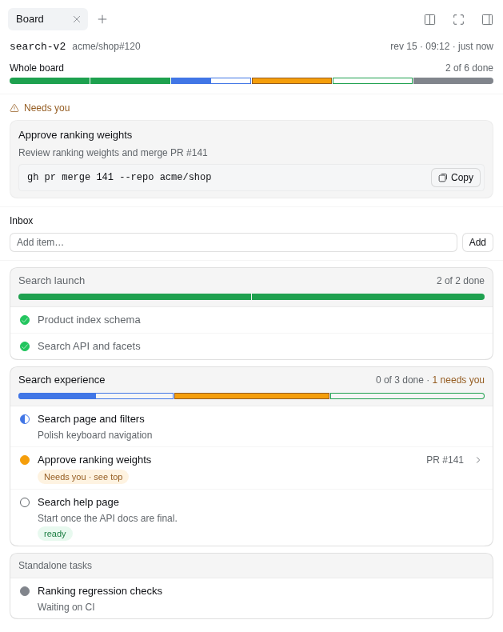
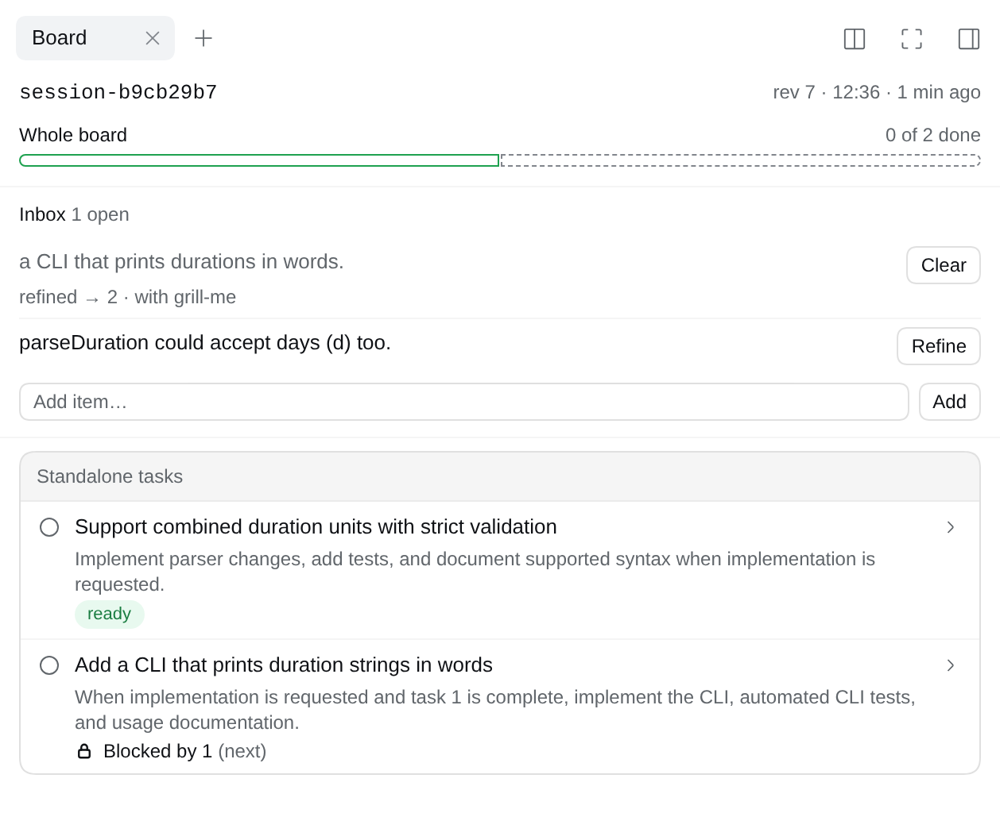
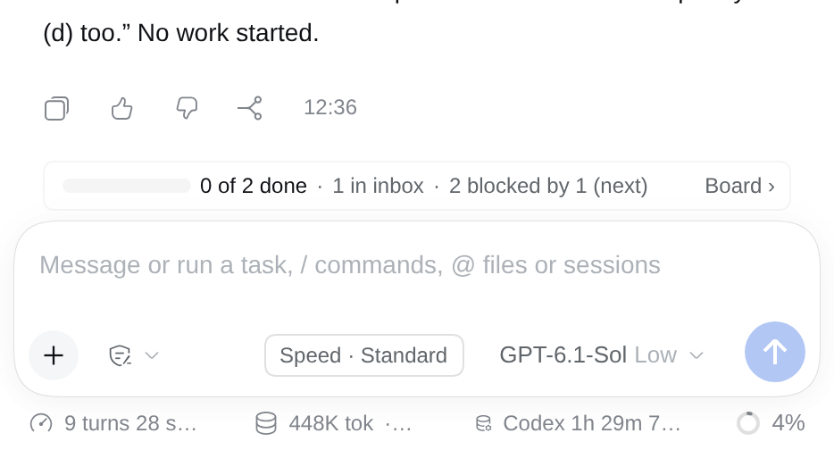
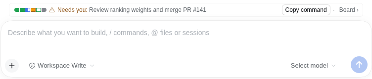
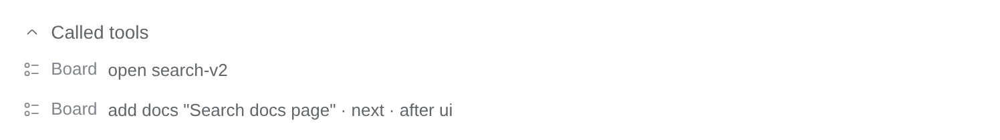

# @rs-dsh/dsh-cockpit

A task board for [DeepSeek Harness](https://github.com/deepseek-ai/deepseek-harness) sessions: the plan for work that takes several steps, from one change across a few files to an effort coordinated across many pull requests. The board is a tree of steps, each linked to its issue and PR, kept as a local file that you and your scripts can read.



## What you get

- **Five board tools** for the agent: open a board, read it, add steps, update them, and keep its Inbox.
- **An Inbox** for rough ideas noted for later, kept on the board but outside its steps until they are refined.
- **The `cockpit-refine` skill**, which turns Inbox items into steps with you, optionally through another skill you prefer.
- **The Board tab** in the web GUI's right sidebar: whole-board progress, a "Needs you" list, separate sections for each top-level parent and its children, and a Standalone tasks section. Each parent has its own local progress. Each step shows its status mark, what is blocked or ready, and links to its PR and issue; hover a mark for its status and a title for the step id. It uses DSH's own icons and status marks, in the light and dark themes.
- **A progress strip** above the chat input: how far the board is, and what is blocked or needs you.
- **A card per board tool call** in the chat.
- **A small reader** for scripts, with no DSH needed.

The panel and the strip only show the board. They run no command and change nothing. The Inbox's buttons put a request in the message box for you to send; the agent makes the change.

## Install

```sh
dsh plugin --profile <name> add @rs-dsh/dsh-cockpit@0.5.0
```

If npm is not an option, install from git, pinned to the release tag: `dsh plugin --profile <name> add 'github:romany-saad/dsh-plugins#dsh-cockpit@0.5.0&path:packages/dsh-cockpit'`.

The Board tab, the strip and the chat cards need a profile with `@deepseek-ai/dsh-web-app`, such as `web`.

## Configure

It works with no config. To change something, add a `dsh-cockpit` row to the profile's `cordis.patch.yml`, naming only what you change. Keep one such row: a row with the same id replaces the whole config, so put every setting you change in it. To link `#12` and `owner/repo#12` to GitHub:

```yaml
- id: dsh-cockpit
  name: '@rs-dsh/dsh-cockpit'
  config:
    links:
      issue: 'https://github.com/{repo}/issues/{number}'
      pr: 'https://github.com/{repo}/pull/{number}'
```

For `#12`, `{repo}` comes from the board's parent ticket. Without `links`, only full URLs become links.

- `tools: { enabled: false }` registers no board tools.
- `route: { enabled: false }` turns off the data the Board tab and the strip read; the tab then says the board is unavailable.
- `planning: { enabled: false }` stops asking agents to plan multi-step work on a board (see Use). They still keep a board current once one is open.
- `inbox: { refineSkill: 'grill-me' }` names the skill `/cockpit-refine` uses for the analysis when you name none (see Inbox). By default it uses its own checklist.

### Drift

Drift is a step whose status no longer matches its work, such as a merged PR on a step that still says `waiting`. The plugin knows no tracker, so the check is a command you configure, `drift: { command: '...', cwd: '...' }`; it runs only when the agent asks for a drift check. What the command gets and must print is in the example and in DEVELOPING.md (linked below). In `mode: report` (the default) it only reports the differences, and the hub decides what to change; in `mode: apply` it sets the reported statuses itself. [`examples/board-drift-gh.sh`](examples/board-drift-gh.sh) is an example to copy: it reports steps whose PR `gh` says is merged.

## Use

Cockpit asks the agent to plan any work that takes several steps on a board, in place of DSH's todo list. Before it starts, the agent opens a board, or keeps using the one the session has, and adds the steps. A question or a one-step request gets no board. While a board is open, the agent keeps its steps and next actions current and checks its work before marking a step done. A subagent doesn't open its own board: it reports to the agent that gave it the task, which records the result.

This is guidance in the agent's instructions, not automatic tracking: check the board and correct it when needed. You can also ask for a board by name. Child sessions have separate bindings.

- **Open a board** with a key, such as `bosla-883`, and optionally the parent ticket. The session stays bound to it, also after a resume.
- **Add steps**, each with what it is and its issue or PR. `parent` puts a step under another; `dependsOn` lists steps that come first, so a step shows as blocked until they are done or dropped. Both must name steps already on the board: the agent adds a step first, then links others to it.
- **Update a step** as the work moves: `next`, `now`, `waiting`, `done` or `dropped`, and a next action.
- **Needs you:** a step with `waitingOn: owner` shows in the "Needs you" list and on the strip, with its next action, and its `readyCommand` to copy when it has one.

## Inbox

When an idea comes up that isn't for now, say so in the chat: "item for later: dark mode for the strip", "todo next: …", "add to the inbox: …". The agent writes it to the board's **Inbox** as you said it and carries on with the current work. If the session has no board yet, the first item opens one, named after the session. You can also type an item into **Add item…** on the Board tab.

Inbox items aren't steps. They don't count in progress, nothing can depend on them, and the strip only says "1 in inbox". They become steps when you refine them.



### Refining items into steps

Type `/cockpit-refine` to refine every open item, or `/cockpit-refine i3 i5` for some of them; **Refine** on an item does the same. The `cockpit-refine` skill then:

1. reads the board and finds what each item relates to: a parent, steps it depends on or blocks, and anything that already covers it;
2. closes the gaps (goal, scope, acceptance, relations, risks), asking you only what it can't work out;
3. proposes the steps the items become, in board terms, and waits for your yes;
4. writes them, each linked to the items it came from, so an item shows "refined → 12, 13".

**Your own skill for the analysis.** `/cockpit-refine i3 using grill-me`, or `inbox.refineSkill` in the config, hands step 2 to another skill in your catalog, such as one that interviews you or writes specs. Cockpit stays in charge of the board: the other skill decides how to analyse and what to ask, and Cockpit decides what gets written and where. An item that needs research rather than your answers can go to a subagent, which returns its analysis; the session writes the steps.

On the Board tab, a refined or dropped item has **Clear**, which hides it from the tab and keeps it in the board file. An item that won't be done is dropped, with a note why.



### Progress

The strip above the message box shows progress across the whole board: one segment per leaf step (a step with no children), including standalone top-level steps. Parents are not counted again, so a completed group cannot hide a waiting step elsewhere on the board. Done and dropped are counted separately. The **Whole board** bar at the top of the Board tab uses the same counts as the strip, and both put their segments in the order the sections are drawn. Below it, each top-level parent and its subtree occupy a separate bordered section; root steps without children appear under **Standalone tasks**. Each parent's local bar counts only its direct children, so its count can differ from the whole-board total. Above 24 leaf steps, the strip uses one continuous bar.


When a step needs you, the strip shows its next action. **Copy command** copies that step's `readyCommand`, and **Board ›** opens the Board tab.



Each board tool call shows as a one-line card in the chat, under **Called tools**.



## Reading a board from a script

```js
import { readBoard, boardTree } from '@rs-dsh/dsh-cockpit/reader'
const board = await readBoard('bosla-883')
console.log(boardTree(board).tree)
```

`listBoards()` lists the keys. Boards are files in `$DSH_HOME/data/dsh-cockpit/boards/` (by default `~/.dsh/data/dsh-cockpit/boards/`).

## Links

- Design and decisions: [issue #1](https://github.com/romany-saad/dsh-plugins/issues/1)
- [CHANGELOG](CHANGELOG.md)
- Working on the plugin: [DEVELOPING.md](https://github.com/romany-saad/dsh-plugins/blob/main/packages/dsh-cockpit/DEVELOPING.md)
- License: [MIT](LICENSE)
