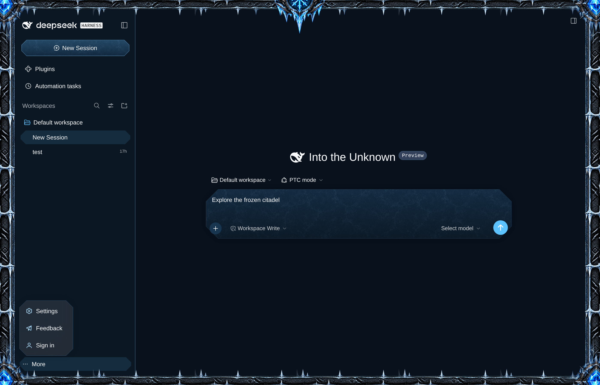
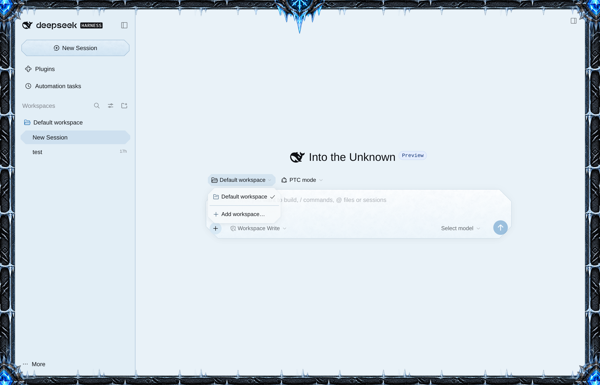
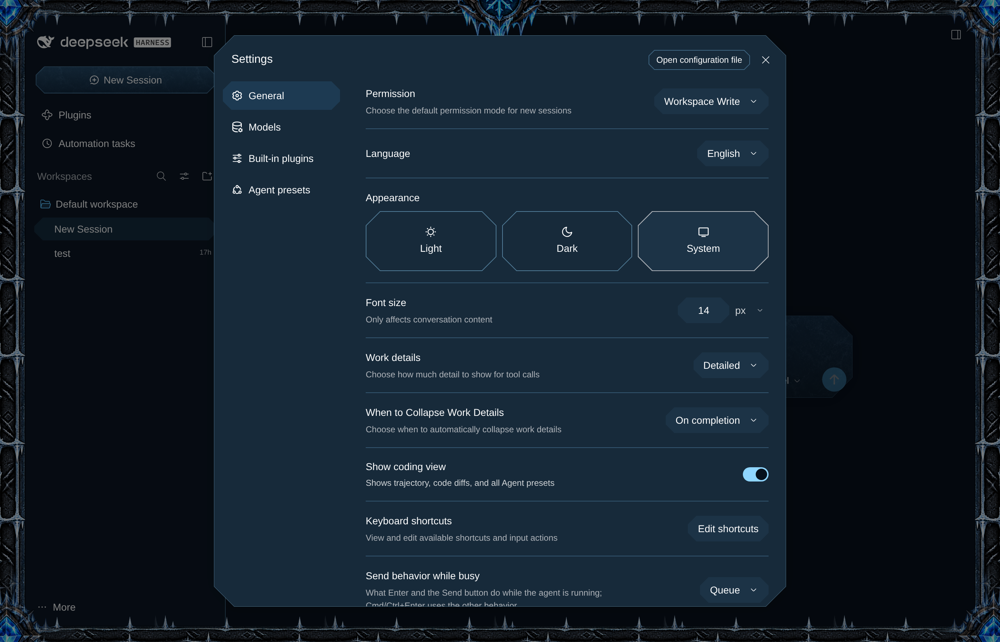
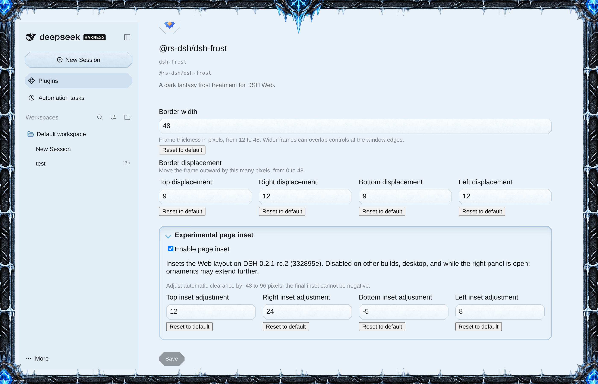

# Frosty Castle Theme

Give DSH Web a frozen-castle look: an icy fantasy frame with long iron rails, downward-hanging ice, crystal corner junctions and a rune crest joined to the trim. Frost adds carved corners, stone-and-ice frames to the composer and panels, and textured styling to selected controls in both light and dark appearance.



## Install

This is a release candidate. It is published to npm's `next` tag, so name the version:

```sh
dsh plugin --profile <name> add @rs-dsh/dsh-frosty-castle-theme@0.1.0-rc.1
```

If npm is not an option, install from git, pinned to the release tag: `dsh plugin --profile <name> add 'github:romany-saad/dsh-plugins#dsh-frosty-castle-theme@0.1.0-rc.1&path:packages/dsh-frosty-castle-theme'`.

From a checkout: `dsh plugin --profile <name> add ./packages/dsh-core ./packages/dsh-frosty-castle-theme`.

## Requirements

DSH 0.2.1-rc.2 and a profile with @deepseek-ai/dsh-web-app.

## Use

Open DSH Web. The frame and palette appear automatically. Choose Light, Dark, or System under Settings → General → Appearance; Frost follows that choice.



Settings and other dialogs share the frost palette and carved corners:



### Border width

Open **Plugins**, select Frost, and choose **Configure**. Enter a **Border width** from 12 to 48 pixels (default 48) and choose **Save**. The frame changes as soon as the value is saved. **Reset to default** returns it to 48.

Use the four responsive **Border displacement** number inputs to move each edge outward independently by 0–48 pixels (defaults: top 9, right 12, bottom 9, left 12). Increasing an edge clips more artwork outside the window; at or beyond the border width it may disappear. The crest follows the top edge. Previously saved uniform displacement remains the fallback for any edge left unset.

Both values are stored in the active profile, survive reloads, and apply after Save. Values outside their ranges cannot be saved.

The collapsible **Experimental page inset** section holds the **Enable page inset** toggle (on by default) and the per-side adjustments. On the verified DSH Web build 0.2.1-rc.2 (commit 332895e), it moves each page edge inward by the border width minus that edge’s displacement. Open the section to use the compact, responsive number inputs to adjust **Top**, **Right**, **Bottom**, and **Left** independently from −48 to +96 pixels (defaults: top −16, right 0, bottom −16, left 0). Each adjustment is added to the automatic inset, with the final inset clamped to zero; save to apply. Turn **Enable page inset** off if it interferes with your layout. It fails closed on other builds and desktop, and is suspended while the right panel is open. Large crest and corner ornaments may still overlap content.



## Limits

The same full icy frame surrounds both appearances. It is drawn over the app; the experimental compatibility inset moves the layout only on its verified Web build and is suspended while the right panel is open. Otherwise the frame can cover edge controls or labels, including at the default width. They still respond to clicks. Reduce the width if this gets in the way. Frost restyles controls through DSH's theme colors and shapes, so it reshapes and recolors them but does not draw artwork on each button or field. Other theme layers can override its colors.

[Changelog](CHANGELOG.md) · [MIT license](LICENSE) · [Development](DEVELOPING.md)
